<picture>
  <source media="(prefers-color-scheme: dark)" srcset="./assets/header-dark.svg" />
  <source media="(prefers-color-scheme: light)" srcset="./assets/header-light.svg" />
  
</picture>

 

### Actividad

<picture>
  <source media="(prefers-color-scheme: dark)" srcset="./assets/commit-invaders-dark.svg" />
  <source media="(prefers-color-scheme: light)" srcset="./assets/commit-invaders-light.svg" />
  
</picture>

---

### Proyectos y repositorios

| Proyecto | Stack | Descripción |
|---|---|---|
| [**agy-telegram**](https://github.com/adriaangonz/agy-telegram) | `Python` · `Whisper` | Puente de Telegram para usar Antigravity CLI desde el móvil con texto, voz, imágenes, vídeos y documentos. |
| [**AD**](https://github.com/adriaangonz/AD) · [**PSP**](https://github.com/adriaangonz/PSP) · [**DI**](https://github.com/adriaangonz/DI) · [**DevOps**](https://github.com/adriaangonz/DevOps) | `Java` · `C#` · `SQL` · `Docker` | Prácticas de 2.º DAM: acceso a datos (JDBC), programación concurrente, interfaces gráficas y contenedores. |
| [**JavaLand_Equipo4**](https://github.com/adriaangonz/JavaLand_Equipo4) | `Java` | Proyecto en equipo desarrollado en 1.º DAM. |

---

### Stack

---

### Contacto

